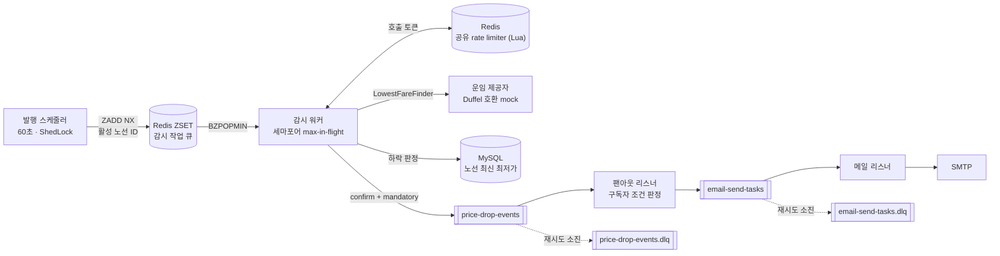
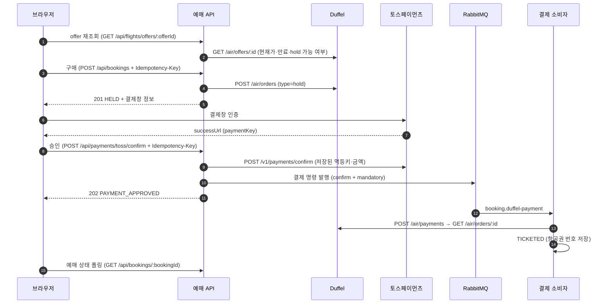
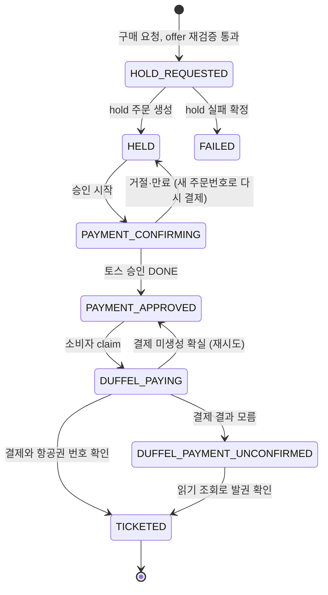

# ✈️ Flight Monitor

구독한 항공 노선의 최저가를 주기적으로 감시하다가 가격이 떨어지면 조건에 맞는 구독자에게 이메일로 알리고, 찾은 항공권을 검색부터 결제·발권 확인까지 이어서 처리하는 서비스입니다.

- **가격 감시·알림**: 여러 대의 앱 서버가 외부 운임 API의 전역 호출 한도를 함께 지키면서 노선을 감시하고, 가격 하락 알림이 조용히 사라지지 않게 합니다.
- **예매·결제**: [Duffel](https://duffel.com) 테스트 API(허용 항공사 `ZZ` Duffel Airways)와 [토스페이먼츠](https://www.tosspayments.com) 테스트 API에 실제로 연결합니다. 결과를 모르는 재요청이 생겨도 중복 결제가 일어나지 않게 합니다.
- 가격 감시는 호출 한도와 응답 지연을 조절할 수 있는 Duffel 호환 mock 운임 API로 돌립니다. 같은 애플리케이션을 `mock` 프로필로 띄워 제공합니다.

## 목차

- [주요 기능](#주요-기능)
- [기술 스택](#기술-스택)
- [아키텍처](#아키텍처)
  - [가격 감시 → 알림 파이프라인](#1-가격-감시--알림-파이프라인)
  - [예매·결제 흐름](#2-예매결제-흐름)
- [문제 해결 기록](#문제-해결-기록)
- [프로젝트 구조](#프로젝트-구조)
- [실행 방법](#실행-방법)
- [주요 설정값](#주요-설정값)
- [범위 밖](#범위-밖)

## 주요 기능

| 기능 | 설명 |
|---|---|
| 노선 구독 | 출발·도착 공항, 출발일, 좌석 등급으로 노선을 구독합니다. 목표 가격과 하락률(%) 조건을 걸 수 있습니다 |
| 최저가 감시 | 구독자가 있는 노선을 60초 주기로 조회해 최신 최저가를 저장합니다 |
| 가격 하락 알림 | 가격이 떨어지면 구독자별 조건을 판정해 이메일을 보냅니다. 조건이 없으면 모든 하락에, 조건이 있으면 둘 중 하나만 만족해도 알립니다 |
| 항공권 예매 | 검색 → offer 재조회 → 승객 정보 입력 → Duffel hold 주문 → 토스 결제 승인 → Duffel 결제와 항공권 번호 확인 |
| 인증 | Google ID 토큰을 검증한 뒤 JWT(access·refresh)를 발급합니다 |

## 기술 스택

| 구분 | 사용 기술 |
|---|---|
| 언어·프레임워크 | Java 21, Spring Boot 4.0, Spring Data JPA, Gradle |
| 저장소 | MySQL 8.4, Flyway |
| 작업 큐·조정 | Redis 7 (감시 작업 큐, 공유 rate limiter, ShedLock), Redisson |
| 메시징 | RabbitMQ 4.3 (publisher confirm, DLX·DLQ) |
| 장애 대응 | Resilience4j Circuit Breaker |
| 외부 API | Duffel API v2 (테스트 모드), 토스페이먼츠 결제 API (테스트 키) |
| 관측 | Micrometer, Prometheus, Grafana |
| 테스트 | JUnit 5, Testcontainers (Redis·RabbitMQ), ArchUnit, H2 |
| 인프라 | Docker Compose |

## 아키텍처

### 1. 가격 감시 → 알림 파이프라인



| 문제 | 해결 |
|---|---|
| 앱 서버가 여러 대일 때 같은 노선이 중복으로 쌓임 | ShedLock(Redis)으로 발행 스케줄러를 한 서버에서만 실행합니다. 큐는 `ZADD NX`라 이미 기다리는 노선은 무시되고, 큐 길이는 활성 노선 수를 넘지 않습니다 |
| 서버마다 따로 세면 외부 API 전역 한도를 넘음 | Redis Lua 스크립트로 모든 서버·워커가 토큰을 공유합니다. 기본값은 업체 한도(60초당 30건)의 90%입니다. 429를 받으면 응답의 재개 시각까지 모든 서버가 호출을 멈춥니다 |
| Redis 장애 때 rate limiter가 감시를 멈춤 | 서킷 브레이커가 열리면 서버마다 로컬 버킷(전역 한도 ÷ 서버 수)으로 계속 셉니다 |
| 외부 API 응답이 느려지면 처리 스레드가 고갈됨 | 세마포어로 동시 호출 수를 제한하고, 넘치는 작업은 Redis 큐에 남겨 둡니다. 상한은 `호출 한도 × 응답 시간 p99`로 산정합니다 |
| 가격 하락 이벤트가 유실되면 다시 감지되지 않음 | 하락 판정 기준인 최신가를 브로커 확인(confirm과 라우팅) **뒤에만** 갱신합니다. 확인을 못 받으면 다음 주기에 같은 하락을 다시 감지합니다 ([아래](#가격-하락-알림-영구-유실-60건--0건)) |
| 팬아웃·메일 발송 일시 장애 | 블로킹 재시도(1 → 2 → 4 → 8 → 16초, 총 31초)로 흡수하고, 다 쓰면 DLQ로 보냅니다 |

- 감시 스케줄러·워커·리스너는 `mock` 프로필 인스턴스에서는 꺼집니다.
- 외부 운임 제공자는 `LowestFareFinder` 포트 뒤에 두었습니다. mock과 실제 Duffel은 `fare-provider.duffel.base-url`과 토큰만 바꿔 전환합니다.
- 메일은 `prod` 프로필에서만 실제 SMTP로 보내고, `dev`·`docker` 프로필은 장애 주입이 가능한 mock 메일 서비스를 씁니다.

### 2. 예매·결제 흐름



#### 예매 상태



#### 중복 결제 방지 — 경계마다 다른 멱등 전략

| 경계 | 방식 |
|---|---|
| 우리 API (구매·승인) | `Idempotency-Key` 헤더가 필수입니다. `idempotency_keys`의 유니크 `(user_id, scope, idem_key)`로 한 서버만 처리권을 얻습니다. 끝난 키는 저장된 응답을 그대로 재생하고, 처리 중이면 `409` + `Retry-After`, 같은 키에 다른 본문이면 `422`를 돌려줍니다 |
| 토스 승인 | hold 때 저장한 멱등키와 금액으로 승인합니다. 결과가 불명확하면(타임아웃·5xx·409) 결제 조회로 먼저 확인하고, `IN_PROGRESS`일 때만 다시 보냅니다. 같은 키가 이전 5xx·409만 재생하면 새 키로 재승인합니다. 같은 `paymentKey`의 두 번째 승인은 토스가 `ALREADY_PROCESSED_PAYMENT`로 막습니다 |
| Duffel hold 결제 | Duffel 결제 API에는 멱등키가 없습니다. 그래서 결과를 모르면 재시도하지 않고 `DUFFEL_PAYMENT_UNCONFIRMED`로 보류합니다. 확인 스케줄러는 읽기 조회로만 확인하고, 미결제로 보여도 다시 결제하지 않습니다 |

#### 앱 서버 여러 대를 전제로 한 규칙

1. **상태 전이는 조건부 UPDATE로만 합니다.** `UPDATE … WHERE id = ? AND status = ?`의 영향 행이 0이면 다른 서버가 먼저 바꾼 것이므로 외부 호출을 하지 않습니다.
2. **새 행의 중복은 DB 유니크 제약으로 막습니다.** 멱등키, 토스 주문번호, `paymentKey`가 대상입니다.
3. **시각은 DB `NOW(6)` 기준입니다.** 서버 간 시계 차이가 stale 판정에 섞이지 않습니다.
4. **외부 API 호출은 DB 트랜잭션 밖에서 합니다.** 짧은 트랜잭션을 먼저 커밋해 다른 서버가 보게 한 뒤 호출합니다.
5. **결과를 모르는 채 멈춘 예매는 확인 스케줄러(60초)가 복구합니다.** 락 없이 모든 서버에서 돌며 읽기 조회, 미승인 확인 뒤 토스 재승인, 결제 명령 재발행만 합니다. 재발행으로 생긴 중복 메시지는 소비자의 claim(조건부 UPDATE)이 하나만 통과시킵니다.

## 문제 해결 기록

### 가격 하락 알림 영구 유실 (60건 → 0건)

**문제** — 하락 여부는 "이번 관측가 < 저장된 최신가"로 판정합니다. 그런데 최신가를 먼저 커밋하고 이벤트를 나중에 발행했기 때문에, 발행이 실패하면 다음 주기에는 같은 가격이 더 이상 하락이 아니었습니다. 알림이 다시는 감지되지 않고 조용히 사라졌습니다. 팬아웃 리스너도 예외를 삼키고 정상 ack를 보내고 있었습니다.

**선택** — DB와 브로커에 함께 쓰는 이중 쓰기 문제라서 Transactional Outbox도 검토했습니다. 하지만 가격 하락 이벤트는 "외부 운임 vs 저장된 최신가"에서 언제든 다시 만들 수 있습니다. 그래서 이벤트를 저장하는 대신 **최신가(커서)를 브로커 확인 뒤에만 전진**시켰습니다. 다음 감시 주기가 그대로 재시도 역할을 하고, 새 테이블이나 릴레이가 필요 없습니다. 팬아웃은 예외를 던지게 바꾸고, 재시도 뒤 DLQ로 보내도록 했습니다.

**결과** — Docker Compose 환경에서 노선 60개에 동시에 가격 하락을 일으켜 측정했습니다.

| 장애 시나리오 | before 영구 유실 | after 영구 유실 |
|---|---|---|
| 브로커 정지 약 90초 | **60** | **0** (재기동 뒤 다음 주기에 60건 모두 재감지·발송) |
| 팬아웃 중 DB 장애 | **60** | **0** (발송 33 + DLQ 27) |
| 앱 강제 종료 ×3 | 0 | 0 |

- 트레이드오프: 브로커 확인 뒤 최신가를 반영하기 전에 앱이 죽거나 확인 대기 시간을 넘긴 뒤 ack가 오면 같은 알림이 두 번 갈 수 있습니다. 알림은 놓치는 것이 두 번 받는 것보다 나쁘다고 보고 중복을 받아들였습니다.

### 결제 장애 주입 E2E (Duffel·토스 테스트 환경)

| 시나리오 | 주입 방법 | 결과 |
|---|---|---|
| 정상 | 없음 | 검색 → hold → 결제창 → 승인 → Duffel 결제 → `TICKETED` (PNR·항공권 번호 확인) |
| 토스가 같은 키로 500만 재생 | 토스 테스트 코드 헤더 | 조회로 `IN_PROGRESS` 확인 → 새 키 재승인 → `TICKETED` |
| 토스가 같은 키로 409만 재생 | 토스 테스트 코드 헤더 | 같은 키 재요청 전후 409가 이어지면 새 키로 재승인하도록 규칙을 넓혔습니다. 이 실행에서는 승인 기한이 지나 `HELD`로 돌아갔고 다시 결제할 수 있습니다 |
| 승인 직후 앱 강제 종료 | `docker kill` + 브로커 일시정지 | 재기동 뒤 확인 스케줄러가 결제 명령을 재발행 → Duffel 결제 1회 → `TICKETED` |

- E2E 도중 결제 명령이 큐에 들어가지 않았는데도 발행이 성공으로 보이는 문제를 찾았습니다. RabbitMQ는 라우팅되지 않은 메시지에도 ack를 보내기 때문입니다. publisher confirm과 mandatory return을 함께 기다려 라우팅 실패도 실패로 감지하도록 고쳤습니다.

## 프로젝트 구조

```text
src/main/java/com/siwol025/flight_monitor/
├── auth/           # Google 로그인, JWT 발급·검증
├── booking/        # 항공권 검색·예매, 멱등키, 결제 명령 소비자, 확인 스케줄러
├── fare/           # 운임·주문 포트(LowestFareFinder, FlightOfferFinder, FlightOrderGateway)
│   └── adapter/duffel/   # Duffel 어댑터
├── monitor/        # 감시 작업 발행, Redis 큐 소비, rate limiter, 백프레셔
├── notification/   # 가격 하락 이벤트 발행, 팬아웃, 메일 작업 소비
├── payment/        # 결제 포트(PaymentGateway)
│   └── adapter/toss/     # 토스페이먼츠 어댑터
├── route/          # 노선과 최신 운임
├── subscription/   # 구독과 알림 조건
├── user/           # 사용자
├── mock/           # Duffel 호환 mock 운임 API와 기동 시 시딩
└── global/         # 공통 설정·예외
src/main/resources/
├── db/migration/   # Flyway 마이그레이션
└── static/         # 검색·예매·결제 화면 (HTML + 바닐라 JS)
```

도메인 간 의존 방향은 ArchUnit 테스트(`ArchitectureRulesTest`)로 검사합니다.

- `route`는 다른 도메인에 의존하지 않고, `fare`·`subscription`이 `route`를 사용합니다.
- `monitor`는 조회·구독·알림 기능을 조합합니다.
- `payment`는 다른 도메인에 의존하지 않고 `booking`만 사용합니다.
- 외부 제공자 어댑터와 mock 구현은 다른 도메인에 노출하지 않습니다.

## 실행 방법

### 1. 사전 준비

- JDK 21, Docker
- 프로젝트 루트에 `.env`를 만듭니다. 이 파일은 커밋하지 않습니다.

```dotenv
DB_USERNAME=
DB_PASSWORD=
RABBITMQ_USERNAME=
RABBITMQ_PASSWORD=

# 32바이트 이상
JWT_SECRET=
OAUTH2_GOOGLE_CLIENT_ID=
OAUTH2_GOOGLE_CLIENT_SECRET=

# 실제 SMTP 발송은 prod 프로필에서만 사용
MAIL_USERNAME=
MAIL_PASSWORD=

# 예매용 Duffel 키. duffel_test_로 시작하지 않으면 기동에 실패합니다
DUFFEL_API_TOKEN=duffel_test_...
# 토스페이먼츠 테스트 키. 시크릿 키가 test_로 시작하지 않으면 기동에 실패합니다
TOSS_CLIENT_KEY=test_ck_...
TOSS_SECRET_KEY=test_sk_...
```

### 2. Docker Compose로 실행

```bash
./gradlew clean bootJar
docker build -t flight-monitor-app .
docker compose up -d
```

스키마는 앱이 기동할 때 Flyway가 적용합니다. mock 인스턴스는 기동할 때 오늘부터 30일치 가짜 항공편·가격·좌석을 비어 있는 날짜에만 채웁니다.

| 서비스 | 주소 | 설명 |
|---|---|---|
| flight-app | http://localhost:8080 | 본 앱 (`docker` 프로필). 검색·예매 화면 |
| Swagger UI | http://localhost:8080/swagger-ui/index.html | API 문서 |
| flight-mock-api | http://localhost:8081 | mock 운임 API (`docker`, `mock` 프로필) |
| RabbitMQ 관리 화면 | http://localhost:15672 | `.env`의 RabbitMQ 계정 |
| Prometheus | http://localhost:9090 | |
| Grafana | http://localhost:3000 | 파이프라인 처리량 대시보드 |
| MySQL | `127.0.0.1:3307` | |

- 화면에서 예매하려면 `POST /api/login/google`로 받은 access token을 화면에 입력합니다.
- 결제는 토스페이먼츠 테스트 키로 진행되므로 실제 청구가 일어나지 않습니다.
- 로컬에서 `./gradlew bootRun`으로 띄울 때는 `dev` 프로필 설정(`application-dev.yml`, 커밋하지 않음)에 DB·Redis 주소를 넣습니다.

### 3. 테스트

```bash
# 전체 테스트. Testcontainers 기반 테스트는 Docker가 필요합니다
./gradlew test

# 특정 테스트
./gradlew test --tests '*FlightMonitoringWorkerTest'

# 실제 Duffel 테스트 API로 hold·결제·발권을 확인하는 선택 실행 테스트
DUFFEL_LIVE_TEST=true DUFFEL_API_TOKEN=duffel_test_... ./gradlew test --tests '*DuffelLiveSmokeTest'
```

## 주요 설정값

서버 수나 외부 한도처럼 배포마다 달라지는 값은 코드에 고정하지 않고 프로필 설정(`application*.yml`)이나 같은 이름의 환경 변수로 조정합니다.

| 키 | 기본값 | 설명 |
|---|---|---|
| `monitor.produce.fixed-rate-ms` | `60000` | 감시 주기 |
| `monitor.ratelimiter.limit` / `period` | `27` / `60s` | 모든 서버가 공유하는 외부 API 호출 한도 |
| `monitor.ratelimiter.instances` | `1` | 서버 수. Redis 장애 때 로컬 한도를 나누는 기준 |
| `monitor.backpressure.max-in-flight` | `7` | 동시 외부 호출 상한 |
| `monitor.http.max-connections` | `7` | 감시용 커넥션 풀. `max-in-flight` 이상이어야 기동합니다 |
| `mock.duffel.rate-limit.limit` / `period` | `30` / `60s` | mock 운임 API가 강제하는 업체 한도 |
| `booking.usd-to-krw-rate` | `1400` | 고정 환율 (원 단위 올림) |
| `booking.allowed-owner-codes` | `[ZZ]` | 예매를 허용하는 판매 항공사 |
| `booking.checker.stale-after` | `2m` | 결과를 모르는 예매를 확인 스케줄러가 다시 보기 시작하는 시간 |

Compose 환경(`application-docker.yml`)은 서버 2대와 mock 한도 분당 100건을 기준으로 이 값들을 덮어씁니다.

## 범위 밖

- 보상 트랜잭션: 토스 승인 뒤 Duffel 결제가 확정 실패했을 때의 토스 취소, 발권 후 취소·환불
- `DUFFEL_PAYMENT_UNCONFIRMED`가 미결제로 확인됐을 때의 재결제 (지금은 보류를 유지하고 경고만 남깁니다)
- 결제하지 않은 `HELD` 예매의 만료 처리
- 다중 승객, 좌석 선택, 부가 서비스
- 실시간 환율 (지금은 1 USD = 1,400원 고정)
- 메일 작업 발행의 브로커 확인 대기 (브로커가 받았지만 디스크에 쓰기 전에 죽는 짧은 구간이 남습니다)
